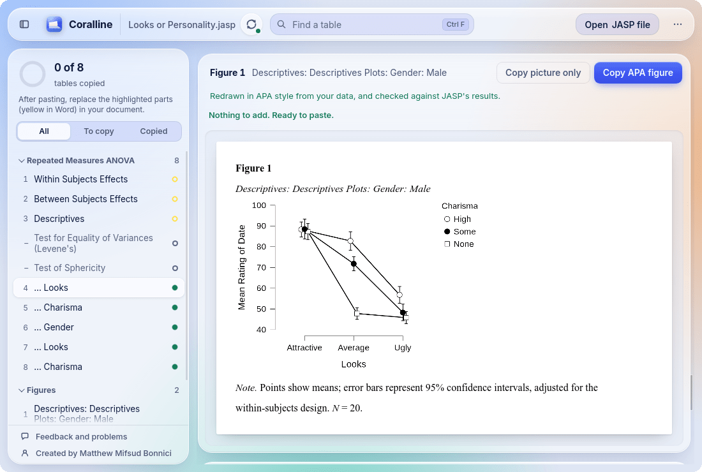
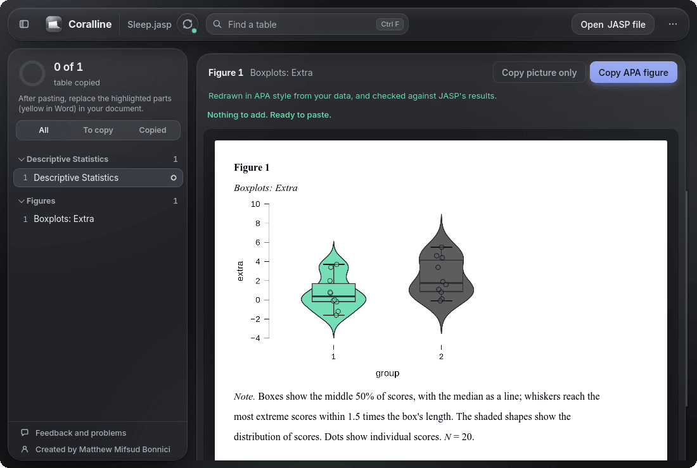
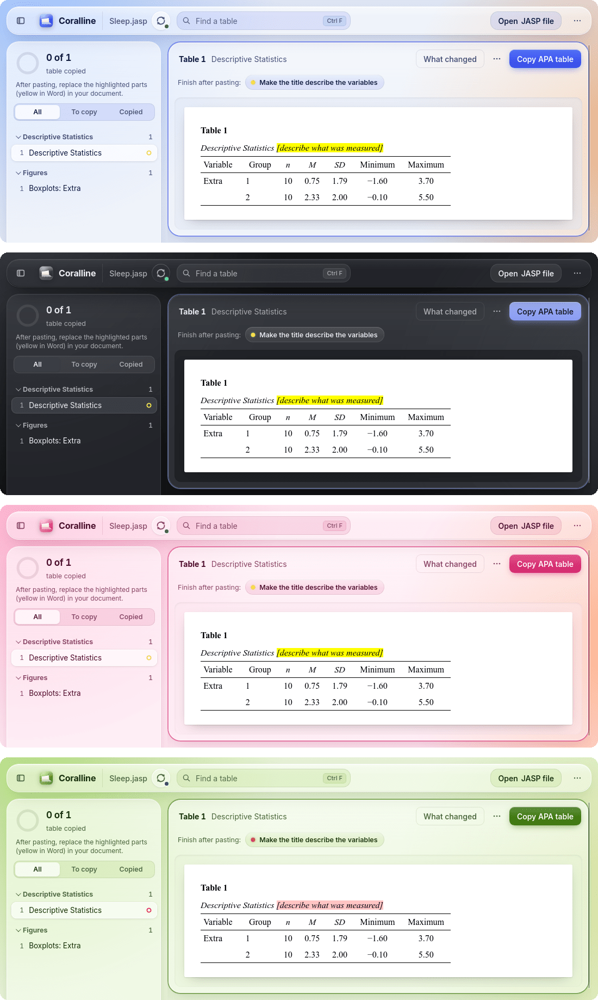

# Coralline

Coralline opens a saved [JASP](https://jasp-stats.org) file and turns every results table in it into an APA 7 table. Click **Copy APA table** and paste into Word or Google Docs. The tables are drawn by JASP's own code, so they show the same values JASP does. Your JASP file is only read, never changed.

## Install

**Windows** (10 or 11): download [install.cmd](https://github.com/onetrickpony1/coralline/releases/latest/download/install.cmd) and double-click it. Windows warns about apps from small developers that few people have downloaded yet: choose **Run** (or **More info**, then **Run anyway**). Run it again whenever you want to update.

**Mac:** download [coralline-install-mac.zip](https://github.com/onetrickpony1/coralline/releases/latest/download/coralline-install-mac.zip), open it, then right-click **install.command** and choose **Open** (a double-click is blocked the first time for apps from outside the App Store). Run it again to update.

**Linux**, or from Terminal on a Mac: paste this line and press Return. Run it again to update.

```sh
curl -LsSf https://raw.githubusercontent.com/onetrickpony1/coralline/main/install.sh | sh
```

Or, on Windows, from PowerShell:

```powershell
powershell -ExecutionPolicy ByPass -c "irm https://raw.githubusercontent.com/onetrickpony1/coralline/main/install.ps1 | iex"
```

- Windows: Coralline goes in `%LOCALAPPDATA%\Programs\coralline`, with a Start menu entry.
- Linux: Coralline goes in `~/.local/share/coralline`, with an app menu entry and the `coralline` command in `~/.local/bin`. It needs WebKitGTK 4.1 (`libwebkit2gtk-4.1-0` on Debian and Ubuntu, `webkit2gtk4.1` on Fedora, `webkit2gtk-4.1` on Arch); the installer tells you if it's missing.
- macOS: installed like on Linux, started with `coralline`.

**Which JASP version**

- **Tables:** Coralline reads `.jasp` files saved by JASP 0.97 or newer. It's tested with files from JASP 0.97, 0.97.1, 0.98 and 0.98.1. Files from older versions may work but aren't tested. You don't need JASP installed to copy tables.
- **Figures** (plots as APA figures): Linux only for now, with JASP installed from [Flathub](https://flathub.org/apps/org.jaspstats.JASP). It's tested with JASP 0.98.1 and 0.99.0. Coralline reruns your analyses in that JASP to redraw the plots. On Windows and Mac, and without JASP, you get the tables only.

## Before you use it

Coralline is a formatting helper. It saves you the fiddly work of making JASP's tables look the way APA 7 asks. It doesn't do your statistics or your thinking for you.

**What it does**

- Takes the tables JASP has already made and lays them out in APA 7 style: the lines, the rounding, the italics, the "Table 1" above and the *Note.* below, with your sample size.
- On Linux, with JASP installed from Flathub, does the same for your plots: each is redrawn in APA style (clear colours, panel letters, no gridlines) and becomes a "Figure 1" with a title and a note.
- Keeps your results as they are. The numbers are JASP's own, only rounded the APA way. Your JASP file is never changed.
- Shows you every change it made, so you can check it.
- Highlights the few things it can't know, like a good title for your table, and tells you what to write.
- Works on your own computer. Your file isn't uploaded anywhere.

**What it doesn't do**

- It doesn't check your analysis. If you picked the wrong test or your data has a mistake, you'll get a neat table with the wrong results in it.
- It doesn't explain your results or write them up. It won't tell you what a result means or whether it matters.
- It doesn't pick which tables belong in your report. That's your choice.
- Graphs and plots only work on Linux so far (see **Which JASP version** above). Elsewhere it does tables only.
- It only sees what you've saved in JASP. Save in JASP first, or your newest results won't be there.
- It doesn't know your course's own rules. If your tutor or marking guide asks for something different from APA 7, do what they say.
- It can't promise a perfect table or figure every time. Look over every one before you hand your work in. It's still your work.

If you aren't sure whether tools like this are allowed on your course, ask your tutor. Coralline is made by one person. It isn't made by the JASP team or by the APA.






## Features

- **APA 7 layout:** "Table N" in bold, an italic title in title case, horizontal rules only, a *Note.* under the table.
- **APA numbers:** 2 decimals, 3 for *p* values, no leading zero for statistics that can't exceed 1, commas in thousands, whole-number *df* where the *df* is whole.
- **APA wording:** sentence-case headings, *M*, *SD*, *SE* and the other standard symbols in italics, readable variable names ("FaceType" becomes "Face type").
- **Sample size:** *N* goes in the note. It comes from what the analysis reports or, when its tables don't say, from the data saved in the file (rows that pass the filter with no missing values in the analysis's variables).
- **Layouts APA expects:** descriptive statistics with variables in rows, correlation matrices with numbered columns and asterisks instead of *p* rows.
- **What only you can add is highlighted:** a vague title, a missing heading or an unclear abbreviation is marked in yellow in the pasted table. Under each table, click a to-do for what to write, with an example, and how to remove the yellow afterwards.
- **Fits the page:** tables paste in Times New Roman 12, with column widths measured so nothing wraps. A wide table steps down to as little as 9 pt. If it's still too wide, it asks for a landscape page, and if even that's too narrow, it asks you to split the table.
- **APA figures** (Linux, with JASP from Flathub): the file's plots appear below the tables as APA figures, with their own numbers, a title and a note. Each plot is redrawn in APA style from your data when Coralline's rerun matches JASP's results. Otherwise JASP's own picture goes inside the APA title and note. A figure too wide for the page asks for a landscape page.

In the app:

- **Only the tables for your report:** assumption checks (normality, equal variances) start out of the numbering, and you can leave out or put back any table. The tables after it are renumbered. Two descriptives tables with the same numbers are pointed out.
- **Copy one table or all of them**, for Word and Google Docs or as plain text with tabs between columns. The list shows which tables you've copied, remembers it for next time, and says what's still to do in your document. If a copied table gets a new number or new values, it asks you to copy it again.
- **See what changed:** **What changed** on each table (or <kbd>W</kbd>) lists every APA 7 rule that changed something, with each value before and after ("Std. Deviation" to *SD*, "0.3967" to ".40") and the APA section it comes from.
- **Reloads when JASP saves the file**, keeping your place. If the file can't be read, it says so and keeps trying.
- **Find and filter:** search tables by name, number ("table 3") or a variable in them ("adverts"), or show only the tables still to copy.
- **Number the first table** to match your paper (start at Table 4 if three tables come before). Each file remembers its own.
- **Light, dark, pink and green themes** (green is JASP's own), or follow the system. Works in a narrow window too: the table list opens as a drawer.
- **Hide the table list** (or press <kbd>B</kbd>) to give the tables the whole window.
- **Feedback and problems** at the bottom of the table list (and in the menu) opens a GitHub issue with the version and system filled in (needs a free GitHub account).
- **Recent files** (also in the menu once a file is open), preview size, and keyboard shortcuts for everything (press <kbd>F1</kbd>). Single-key shortcuts can be turned off in the menu, for screen readers.

The four themes, from the top: light, dark, pink and green. In the green theme the app marks the parts to finish in red, because yellow barely shows on green.



## Use

1. Save your work in JASP.
2. Open the `.jasp` file in Coralline: drop it on the window, or click **Open JASP file**. You can also start it with a file: `coralline results.jasp`.
3. Click **Copy APA table** on a table (or press <kbd>C</kbd>; <kbd>K</kbd> goes to the next table and <kbd>J</kbd> to the previous one), then paste it into your document.
4. Replace what is highlighted in yellow (click the to-do under the table for what to write), then remove the yellow: in Word, **Home › Text Highlight Colour › No Colour**; in Google Docs, the highlighter, then **None**.

To see a file's tables as JSON instead: `coralline --json results.jasp`.

## Notes

- Coralline was called jAPAsp up to version 0.1.0. Installing Coralline removes the old jAPAsp, and your settings move over.
- Only what is saved in the file is shown. Save again in JASP and the app reloads the tables by itself.
- Tables are numbered in the order they appear in the file, from the number set in the menu.
- **Limitation:** means, *SD*s and similar values always keep the zero before the decimal point (0.45), as APA asks for statistics that can be greater than 1. For a variable that can't go above 1, such as a proportion from 0 to 1, APA's rule would also allow .45, but the app can't tell a variable's limits from the file. Remove those zeros by hand if you want them gone.
- macOS builds are new: tell us through **Feedback and problems** if anything looks wrong.
- The APA code sits in JASP's own results-page code (`ui/vendor/jasp`), so the tables come out as JASP draws them.
- The APA 7 rules for figures, each with its source in the Publication Manual and how far Coralline meets it: [docs/figures/RULES.md](docs/figures/RULES.md).
- Building from source and the tests: [docs/DEVELOPMENT.md](docs/DEVELOPMENT.md). Bug reports and fixes: [CONTRIBUTING.md](CONTRIBUTING.md).

## License

AGPL-3.0-or-later, because the table code comes from JASP, which is AGPL-3.0. See [LICENSE](LICENSE).
