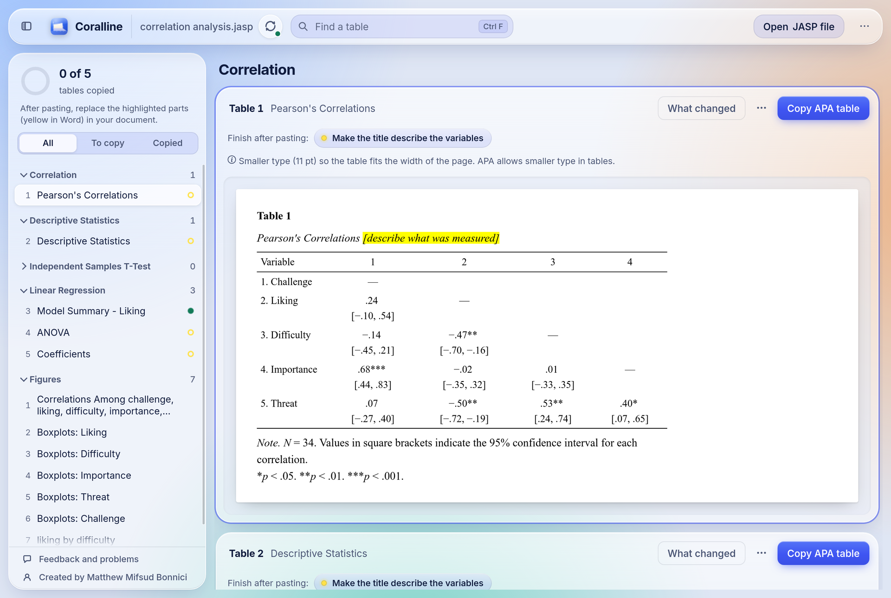

# jAPAsp

jAPAsp opens a saved [JASP](https://jasp-stats.org) file and turns every results table in it into an APA 7 table. Click **Copy APA table** and paste into Word or Google Docs. The tables are drawn by JASP's own code, so they show the same values JASP does.



## Features

- **APA 7 layout:** "Table N" in bold, an italic title in title case, horizontal rules only, a *Note.* under the table.
- **APA numbers:** 2 decimals, 3 for *p* values, no leading zero for statistics that can't exceed 1, commas in thousands, whole-number *df*.
- **APA wording:** sentence-case headings, *M*, *SD*, *SE* and the other standard symbols in italics, readable variable names ("FaceType" becomes "Face type").
- **Sample size:** *N* goes in the note. It comes from what the analysis reports or, when its tables don't say, from the data saved in the file (rows that pass the filter with no missing values in the analysis's variables).
- **Layouts APA expects:** descriptive statistics with variables in rows, correlation matrices with numbered columns and asterisks instead of *p* rows.
- **What only you can add is highlighted:** a vague title, a missing heading or an unclear abbreviation is marked in yellow in the pasted table, and listed under each table in the app.
- **Fits the page:** column widths are measured so nothing wraps, and wide tables step down to a smaller type size.

In the app:

- **Light, dark and pink themes**, or follow the system.
- **Reloads when JASP saves the file**, keeping your place.
- **Find and filter:** search tables by name, or show only the ones still to do or ready to paste. A ring shows how many are ready.
- **Copy one table or all of them**, for Word and Google Docs or as plain text with tabs between columns.
- **Number the first table** to match your paper (start at Table 4 if three tables come before).
- **See what changed:** **What changed** on each table (or <kbd>W</kbd>) lists every APA 7 rule that changed something, with each value before and after ("Std. Deviation" to *SD*, "0.3967" to ".40") and the APA section it comes from.
- **Jump to each highlight** by clicking the to-do under a table. Hide highlights in the preview to check the layout (copies keep them).
- **Hide the table list** (or press <kbd>B</kbd>) to give the tables the whole window.
- **Feedback and problems** at the bottom of the table list (and in the menu) opens a GitHub issue with the version and system filled in.
- **Recent files**, preview size, and keyboard shortcuts for everything (press <kbd>?</kbd>).

## Install

**Windows** (10 or 11):

```powershell
powershell -ExecutionPolicy ByPass -c "irm https://raw.githubusercontent.com/onetrickpony1/jAPAsp/main/install.ps1 | iex"
```

**Linux / macOS**:

```sh
curl -LsSf https://raw.githubusercontent.com/onetrickpony1/jAPAsp/main/install.sh | sh
```

Run the same line again to update. You can also download `install.cmd` (Windows) or `install.command` (macOS) and double-click it.

- Windows: jAPAsp goes in `%LOCALAPPDATA%\Programs\japasp`, with a Start menu entry. It uses the WebView2 runtime that comes with Windows.
- Linux: jAPAsp goes in `~/.local/share/japasp`, with an app menu entry and the `japasp` command in `~/.local/bin`. It needs WebKitGTK 4.1 (`libwebkit2gtk-4.1-0` on Debian and Ubuntu, `webkit2gtk4.1` on Fedora, `webkit2gtk-4.1` on Arch); the installer tells you if it's missing.
- macOS: installed like on Linux, started with `japasp`. It is built for macOS but not tested there.

## Use

1. Save your work in JASP.
2. Open the `.jasp` file in jAPAsp: drop it on the window, or click **Open JASP file**. You can also start it with a file: `japasp results.jasp`.
3. Click **Copy APA table** on a table (or press <kbd>C</kbd>; <kbd>J</kbd> and <kbd>K</kbd> move between tables), then paste it into your document.
4. Fix what is highlighted in yellow, then remove the highlight.

To see a file's tables as JSON instead: `japasp --json results.jasp`.

## Notes

- Only what is saved in the file is shown. Save again in JASP and the app reloads the tables by itself.
- Tables are numbered in the order they appear in the file, from the number set in the menu.
- **Limitation:** means, *SD*s and similar values always keep the zero before the decimal point (0.45), as APA asks for statistics that can be greater than 1. For a variable that can't go above 1, such as a proportion from 0 to 1, APA's rule would also allow .45, but the app can't tell a variable's limits from the file. Remove those zeros by hand if you want them gone.
- The APA code sits in JASP's own results-page code (`ui/vendor/jasp`), so the tables come out as JASP draws them.
- Building from source and the tests: [docs/DEVELOPMENT.md](docs/DEVELOPMENT.md).

## License

AGPL-3.0-or-later, because the table code comes from JASP, which is AGPL-3.0. See [LICENSE](LICENSE).
